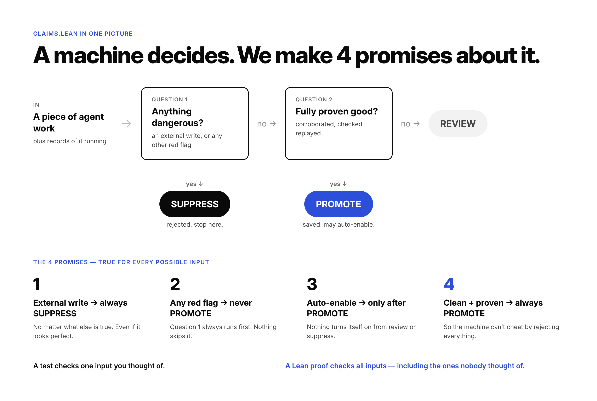

# promotion-atom

A deterministic decision kernel for deciding whether successful agent work should be promoted into a reusable artifact.

```text
candidate + execution evidence + catalog snapshot + owner policy
  → promote | review | suppress
```

## Status

Implemented and locally verified against a frozen synthetic corpus. The API remains pre-1.0. This repository is unpublished and the package is private.

## Boundary

The core is synchronous, deterministic, JSON-only, and zero-I/O. It has no runtime dependencies and cannot call a model, read a clock, use randomness, execute candidate code, persist state, operate a registry, or activate an artifact.

Adapters may translate product-specific receipts into the public input schema. Extractors may propose code, names, schemas, or capabilities, but all extractor output remains untrusted input. Promotion and activation are separate: `activationEligible` is advisory data, never a side effect.

## Usage

```js
import { evaluatePromotion } from "promotion-atom";

const decision = evaluatePromotion(candidate, evidence, catalog, policy);
// decision.disposition: "promote" | "review" | "suppress"
```

See:

- `docs/CONTRACT_V1.md` and `contracts/v1.json` — frozen API
- `docs/ARCHITECTURE.md` — module and trust boundaries
- `docs/THREAT_MODEL.md` — fail-closed security model
- `docs/REASON_CODES.md` — stable reason vocabulary
- `docs/INTEGRATION.md` — adapter contract
- `docs/PROVENANCE.md` — implementation provenance
- `contracts/v1-freeze.json` — reproducible freeze hashes and clarifications

## Verification

```sh
npm test
```

The suite covers all 16 frozen fixtures plus determinism, ordering, deduplication, owner isolation, authority monotonicity, marker/extractor non-bypass, budget bounds, replay, and activation eligibility.

## Lean proofs

`lean/` models the decision order in Lean 4 and proves four rules for every input:

1. An external write always suppresses.
2. A hard failure never promotes.
3. Activation requires promote.
4. Clean, corroborated, verified, and replayed work always promotes.



The claims are in `lean/Claims.lean`. The proofs are in `lean/Proofs/Rules.lean`. `lean/lean-gate.lock` pins the claims, so a changed claim fails the check.

```sh
sh <terraloop-mode>/skills/terraloop/lean-gate.sh lean
```

The model covers the decision order only. It treats the other suppress reasons and the readiness checks as given booleans. It is not yet linked to `src/evaluate.js` by a differential test.

## Safety and publication

Do not publish, deploy, or push this repository without explicit owner approval and a fresh OSS provenance audit. No private replay evidence belongs in this repository.
